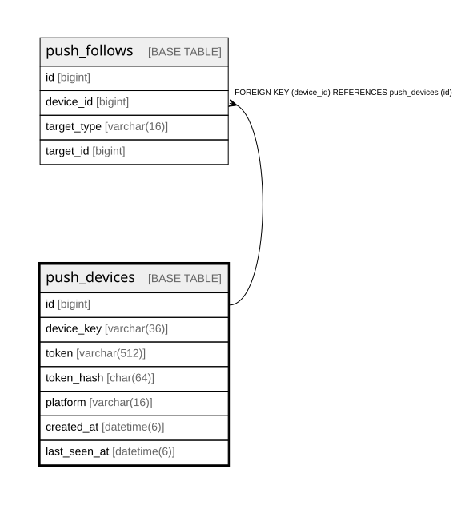

# push_devices

## Description

<details>
<summary><strong>Table Definition</strong></summary>

```sql
CREATE TABLE `push_devices` (
  `id` bigint NOT NULL AUTO_INCREMENT,
  `device_key` varchar(36) NOT NULL,
  `token` varchar(512) NOT NULL,
  `token_hash` char(64) NOT NULL,
  `platform` varchar(16) NOT NULL,
  `created_at` datetime(6) NOT NULL,
  `last_seen_at` datetime(6) NOT NULL,
  PRIMARY KEY (`id`),
  UNIQUE KEY `uc_push_devices_device_key` (`device_key`),
  UNIQUE KEY `uc_push_devices_token_hash` (`token_hash`)
) ENGINE=InnoDB DEFAULT CHARSET=utf8mb4 COLLATE=utf8mb4_0900_ai_ci
```

</details>

## Columns

| Name | Type | Default | Nullable | Extra Definition | Children | Parents | Comment |
| ---- | ---- | ------- | -------- | ---------------- | -------- | ------- | ------- |
| id | bigint |  | false | auto_increment | [push_follows](push_follows.md) |  |  |
| device_key | varchar(36) |  | false |  |  |  |  |
| token | varchar(512) |  | false |  |  |  |  |
| token_hash | char(64) |  | false |  |  |  |  |
| platform | varchar(16) |  | false |  |  |  |  |
| created_at | datetime(6) |  | false |  |  |  |  |
| last_seen_at | datetime(6) |  | false |  |  |  |  |

## Constraints

| Name | Type | Definition |
| ---- | ---- | ---------- |
| PRIMARY | PRIMARY KEY | PRIMARY KEY (id) |
| uc_push_devices_device_key | UNIQUE | UNIQUE KEY uc_push_devices_device_key (device_key) |
| uc_push_devices_token_hash | UNIQUE | UNIQUE KEY uc_push_devices_token_hash (token_hash) |

## Indexes

| Name | Definition |
| ---- | ---------- |
| PRIMARY | PRIMARY KEY (id) USING BTREE |
| uc_push_devices_device_key | UNIQUE KEY uc_push_devices_device_key (device_key) USING BTREE |
| uc_push_devices_token_hash | UNIQUE KEY uc_push_devices_token_hash (token_hash) USING BTREE |

## Relations



---

> Generated by [tbls](https://github.com/k1LoW/tbls)
