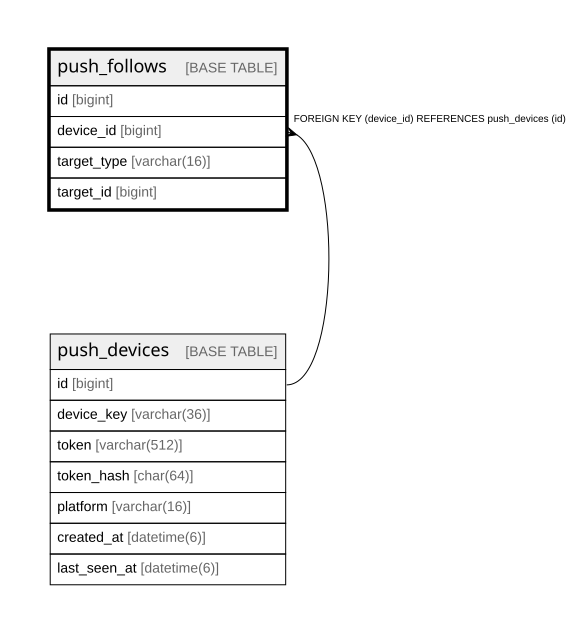

# push_follows

## Description

<details>
<summary><strong>Table Definition</strong></summary>

```sql
CREATE TABLE `push_follows` (
  `id` bigint NOT NULL AUTO_INCREMENT,
  `device_id` bigint NOT NULL,
  `target_type` varchar(16) NOT NULL,
  `target_id` bigint NOT NULL,
  PRIMARY KEY (`id`),
  UNIQUE KEY `uc_push_follows_device_target` (`device_id`,`target_type`,`target_id`),
  KEY `idx_push_follows_target` (`target_type`,`target_id`),
  CONSTRAINT `fk_push_follows_on_push_devices` FOREIGN KEY (`device_id`) REFERENCES `push_devices` (`id`) ON DELETE CASCADE
) ENGINE=InnoDB DEFAULT CHARSET=utf8mb4 COLLATE=utf8mb4_0900_ai_ci
```

</details>

## Columns

| Name | Type | Default | Nullable | Extra Definition | Children | Parents | Comment |
| ---- | ---- | ------- | -------- | ---------------- | -------- | ------- | ------- |
| id | bigint |  | false | auto_increment |  |  |  |
| device_id | bigint |  | false |  |  | [push_devices](push_devices.md) |  |
| target_type | varchar(16) |  | false |  |  |  |  |
| target_id | bigint |  | false |  |  |  |  |

## Constraints

| Name | Type | Definition |
| ---- | ---- | ---------- |
| fk_push_follows_on_push_devices | FOREIGN KEY | FOREIGN KEY (device_id) REFERENCES push_devices (id) |
| PRIMARY | PRIMARY KEY | PRIMARY KEY (id) |
| uc_push_follows_device_target | UNIQUE | UNIQUE KEY uc_push_follows_device_target (device_id, target_type, target_id) |

## Indexes

| Name | Definition |
| ---- | ---------- |
| idx_push_follows_target | KEY idx_push_follows_target (target_type, target_id) USING BTREE |
| PRIMARY | PRIMARY KEY (id) USING BTREE |
| uc_push_follows_device_target | UNIQUE KEY uc_push_follows_device_target (device_id, target_type, target_id) USING BTREE |

## Relations



---

> Generated by [tbls](https://github.com/k1LoW/tbls)
